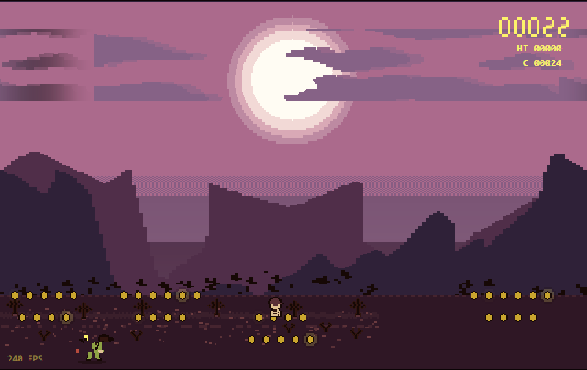

# Wallpaper Runner

**把你自己的桌面壁纸，逆向成一款不用手玩的像素跑酷游戏 —— 单文件、零依赖、双击就跑。**



游戏画面里的**每一个像素都来自同一张壁纸**：角色精灵是从壁纸里裁 124×116 区块、按 4px 网格量化成的 37×34 美术像素（保留原色 `#8fa345` 身体 / `#fbe1b0` 肚皮 / `#feffed` 眼白 / `#b64b3c` 舌头）；天空是沿无云列采样出的 5 段色带；云是按色彩距离分割出的 640×84 掩码；山与针叶林是每 4px 采样一次的轮廓线；地面是照壁纸土壤色板程序化生成的土纹。

下载 [`wallpaper-runner.html`](wallpaper-runner.html) 双击即可。**无键盘、无鼠标、无触摸、无网络、无外部资源** —— 角色自动奔跑、自动跳跃/下蹲/换道，撞到障碍就显示本局成绩、1.1 秒后自动重开。

## 为什么它不是"又一个跑酷 demo"

| 工程点 | 说明 |
|---|---|
| **素材同源而不是描摹** | 逐层提取（`tools/extract_*.py`）而不是画一个像的；调色板直接从壁纸采样，所以游戏和环境天然同色 |
| **一条 lane 基准线** | 美术、碰撞盒、AI 共用 `LANE_Y = [336,360,384]` / `LANE_STEP = 24` / `ART_FOOT = 8`。曾因三者错位 8px，表现为"隔壁道的障碍物把玩家撞死" |
| **AI 是前向模拟，不是规则表** | 以 30 Hz、2.0 s 视野把候选动作（跳/蹲/换道/不动）**真跑一遍**判定安全性，同一次模拟顺带数金币，目标函数：安全 > 金币 > 平滑。变道途中横跨两条道，两条道都做碰撞检查 |
| **验收是可量化的** | 1800 帧零异常、5 seed × 300 s 单局均活 233 s、5 分钟死亡 0.8 次、7 种窗口尺寸比例误差 0.000 %、逻辑 0.44 ms/帧 |

完整的验收表 —— **包括一项刻意没达标的指标及其取舍理由** —— 见 [`docs/acceptance-report.md`](docs/acceptance-report.md)。

## 跑测试

只用 Node 内置模块，无需安装任何东西：

```bash
npm test                  # = smoke + wrap + pickup + unit_sprite
node test/smoke.cjs       # 把产物塞进 DOM/Canvas 桩里真跑 1800 帧（含窗口自适应检查）
node test/wrap_test.cjs   # 云 / 林 tile 的拼接缝检查
node test/pickup_test.cjs # 单枚金币拾取：3 条道 × 9 种高度 + 跳跃弧
node test/unit_sprite.cjs # 精灵构建
node test/soak.cjs 300    # 5 seed × 300 s 完整验收（慢）
node test/record.cjs 25 7 # 软件光栅化出 PNG（frames/frame_25s.png），肉眼验画面
node test/perf.cjs        # 每帧逻辑耗时
```

> `smoke.cjs` 的做法值得单独说：它把构建产物里的 `<script>` 抽出来，在 `vm` 里配一个最小 DOM + Canvas2D 桩**真执行**，所以任何运行期异常都会炸出来 —— 而不是只做语法检查。

## 改它

```bash
python tools/build.py     # src/ + tools/*.json → wallpaper-runner.html（单文件）
```

```
src/game_core.js     调色板 / 精灵构建 / 场景渲染（天空·云·月·山·林·地面）
src/game_world.js    世界模拟 + 自动驾驶 AI（前向模拟决策）
src/game_render.js   角色·障碍·金币·HUD·主循环·自适应缩放
src/shell.html       HTML 外壳
tools/build.py       拼装单文件
tools/mksprites.py   生成障碍/金币精灵 + art.json
tools/extract_*.py   从壁纸提取角色/色带/轮廓/云/地面
```

## 换成你自己的壁纸

提取脚本默认读仓库根目录的 `wallpaper.png`，也可以用环境变量 `WALLPAPER` 指定任意图片：

```bash
WALLPAPER=my-wallpaper.jpg python tools/extract_character.py  # 角色精灵 + 天空色板
WALLPAPER=my-wallpaper.jpg python tools/extract_layers.py     # 山/林轮廓 + 云掩码 → layers.json / cloud_runs.json
python tools/mksprites.py                                     # 障碍/金币精灵 → art.json
python tools/build.py
```

需要 `numpy` + `Pillow`。对壁纸的要求：横版像素风、有明显的地平线与天空/远景/近景分层。若你的壁纸不含可玩元素（这个项目的障碍与金币也是程序化生成的），改 `src/game_world.js` 的生成器即可。

## 已知边界

- **金币收集率约 50 %（目标 70 %）**：金币分布在 3 条跑道上而角色同一时刻只能站 1 条，单道理论上限 33 %；改成多道铺币把上限抬到 ~62 %，再往上只能铺"金币隧道"，会明显破坏同源观感。按"稳定 > 安全 > 同源美术 > 金币率 > 性能上限"的优先级，这里取美术。
- **浏览器实测帧率没测**：无头 Chrome 在开发机上起不来（`Multiple targets are not supported`），改用软件光栅化 + DOM/Canvas 桩做等价验证。游戏左下角常驻实时 FPS 读数，打开即可自己看。

## 授权

代码 MIT。**游戏内的像素美术是作者本人桌面壁纸（Wallpaper Engine，2560×1600）逐层提取、大幅量化降采样后的衍生作品**，此处仅作技术演示：若要商用或再分发美术，请换用你有权使用的壁纸，跑一遍上面的管线重新生成。
